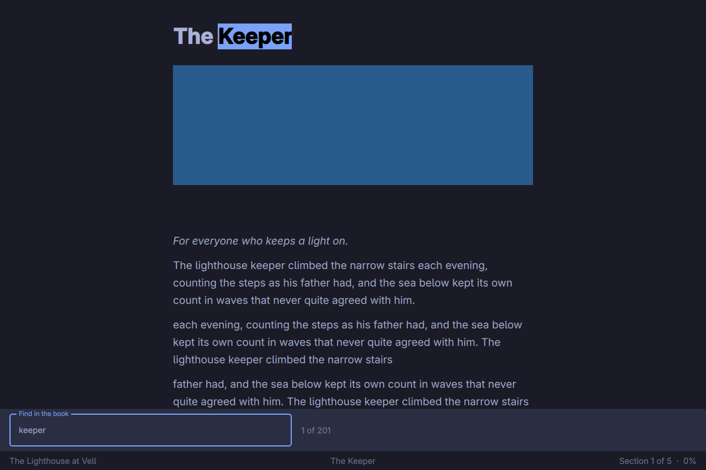
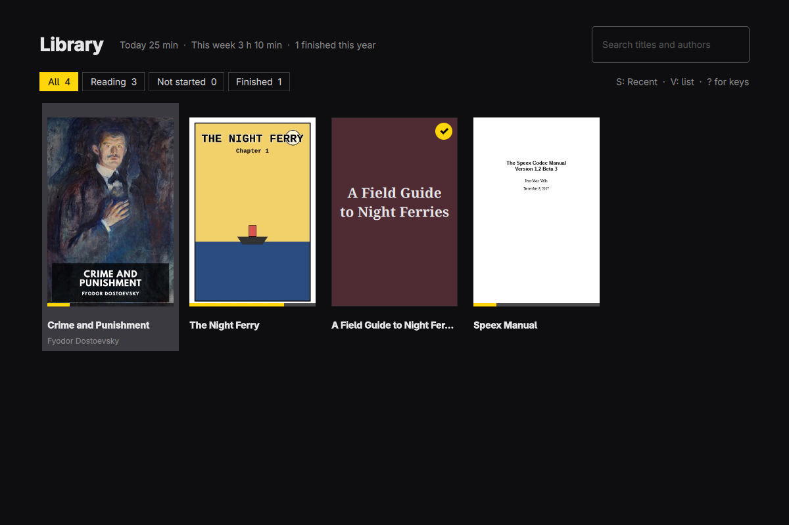

# Omaread



A book reader for [Omarchy](https://omarchy.org). EPUBs, comics and PDF books, read from the keyboard in your theme's colors, and opened again where you stopped.

Omaread is for reading books from start to finish. It follows the Omarchy theme and language as they change, and never changes the files it reads. Markdown and plain text open too; filling in forms and printing PDFs are left to a document viewer.

```sh
omaread open book.epub
```

## Reading

An EPUB is set the way the book itself sets it, from its own stylesheet: first-line indents, small capitals, centered headings, scene breaks, epigraphs, and the indented lines of poems. Its colors and typeface are left out, so every book follows the theme and your reading settings: `S` chooses serif or sans, the text size, line spacing, column width, and ragged or justified lines. Title pages drawn in black ink take the theme's text color.

`Space` turns to the next screen, starting with the line the last one cut off, so the window only ever shows whole lines; `A` chooses how pages turn. A footnote opens over the bottom of the page when its number is chosen, so reading never leaves the page.

The footer names the part and chapter, "Part II · V", and tells the time left in the chapter at your own reading pace, which it learns as you read. `P` switches it to the time left in the book, the page, or the percent read. Pages are counted as `Space` turns them, at your window's size and settings, and progress counts only the book's own text, by its words, so title pages and endnotes don't move it.

## Finding your way

As in Kindle's desktop app, `T` opens the contents in a pane at the window's left, with each chapter's page, and `Ctrl+N` opens the notebook at its right: your bookmarks, highlights and notes together in reading order, filtered by kind with `Tab`. Either or both stay open as you jump from one place to the next, and the text sits between them without changing width, so page numbers stay put. A pane never covers the text: in a window too narrow for both, opening one closes the other, which comes back once the window is wide enough. `G` skims the whole book a page or a chapter at a time, showing each page's first lines, and goes to a page by its number. `/` searches the book for words that begin with what you type, listing each match in the words around it. After any jump, through the contents, a link, a bookmark or a search, `Backspace` goes back to where you were. `Tab` steps through the links and note numbers on the page, for the keyboard.

## Highlights and notes

Choose words with the mouse, or drag across a PDF's page, to highlight them in one of four colors, write a note on them, copy them, or look them up in a dictionary installed on the computer (`sdcv` or `dictd`). `B` bookmarks the page. The notebook (`Ctrl+N`) lists every bookmark, highlight and note in reading order, and `C` there copies them all as Markdown; `omaread highlights book.epub` prints them, bookmarks included.

## The library



The library shows every book you've opened as a cover, with how far you've read, and opens each at the place you stopped. `S` orders it by title, author or progress, `Tab` shows only the books you're reading, haven't started or have finished, `/` searches titles and authors, and `V` switches to a list. A book is marked finished when you reach its end, and `M` marks one by hand. Books you put in `~/Books` join the library by themselves. Beside its name: the time you've read today and this week, and the books finished this year.

The library lives in `~/.local/state/omaread/library.json`, and covers are kept small in `~/.cache/omaread/covers`.

## Comics and PDFs

Pages can be shown two side by side (`D`), fitted to the width (`W`), tinted to the theme (`I`), and trimmed of their white margins (`C`); `Ctrl` with the scroll wheel, or a pinch, zooms around the pointer. `V` reads a comic panel by panel, each one zoomed to fill the window with the rest of the page dimmed. A manga is read right to left when its `ComicInfo.xml` says so, and `R` changes it for any book. A PDF locked with a password asks for it, and never keeps it.

## Commands

The same reading works without a window, for scripts and coding agents. Each command takes `--json`, and `--password` for a locked PDF.

```sh
omaread info book.epub              # title, author, format, sections and contents
omaread text book.epub --section 3  # the words of one section, or of the whole book
omaread search manual.pdf vec3      # where words appear, section by section
omaread highlights book.epub        # your highlights and notes, as Markdown
omaread skill install               # teach coding agents to use these commands
```

## Keys

| Reading | |
| --- | --- |
| `Space` `PgDn` / `Shift+Space` `PgUp` | Next or previous screen |
| `→` `←` | Next or previous screen; the other way round in a book read right to left |
| `↓` `↑` `J` `K` | Scroll |
| `]` `[` `Home` `End` | Next, previous, first or last section |
| `S` | Reading settings: typeface, text size, line spacing, column, alignment |
| `P` | Time left in the chapter or book, the page, or the percent read |
| `A` | How pages turn |
| `+` `−` `0` | Larger, smaller, or reset text and pages |
| `F` | Full screen |

| Finding your way | |
| --- | --- |
| `T` | Contents, in a pane at the left |
| `Ctrl+N` | Notebook: bookmarks, highlights and notes, in a pane at the right (`Tab` filters) |
| `G` | Skim the book, or go to a page |
| `/` `Ctrl+F`, `N` `Shift+N` | Find in the book, and the next or previous match |
| `Backspace` `Shift+Backspace` | Back to where a jump left, and on again |
| `Tab` `Shift+Tab` `Enter` | Choose a link or note on the page, and open it |

| Marking | |
| --- | --- |
| `B` | Bookmark the page, or remove its bookmark |
| `H` | Highlight the words chosen; click a highlight for its color, a note, copying or looking up |
| `Ctrl+C` | Copy the words chosen |

| Comics and PDFs | |
| --- | --- |
| `D` `W` `I` | Two pages side by side, fit to the width, tint like the theme |
| `C` | Trim the white margins |
| `V` | Panel by panel, or whole pages |
| `R` | Right to left, as manga, or left to right |
| `Ctrl`+scroll, pinch | Zoom around the pointer |

| Library | |
| --- | --- |
| `O` | Open a book or document, also by dropping it on the window |
| arrows, `Enter`, `Delete` | Choose a book, open it, or forget it |
| `S` `Tab` `/` `V` | Order, which books, search, covers or a list |
| `M` | Mark a book finished, or not |
| `Esc` | Back to the library |
| `?` `Q` | Show the keys, quit |

## How it reads

- **EPUB**: each chapter is laid out as text, its stylesheet applied by Omaread itself, since Qt's rich text understands little of the CSS books are set with. The table of contents comes from the EPUB 3 nav document, or the EPUB 2 NCX, and the notes from what EPUB 3 marks as footnotes and endnotes.
- **PDF**: drawn page by page with poppler, as Signed draws them, with its outline, links, and words to search and copy.
- **Comics**: the images in a ZIP, RAR, 7z or tar archive, in page-number order, and their `ComicInfo.xml`. Panels are found by the gutters between them.
- **Markdown**: one section for each first- and second-level heading, which make up the table of contents.
- **Text**: split into sections of about 20,000 characters, always between paragraphs.

## Building

You need Qt 6 (base, declarative, svg, wayland, imageformats), poppler-qt6, libarchive, and CMake, all of which Omarchy already installs. The tests also use `qpdf`.

```sh
bin/build    # cmake into build/
bin/test     # build, then run the tests offscreen
cmake --install build --prefix ~/.local   # put it in the app launcher
```

## Translations

The interface is translated into Omarchy's 49 languages, in `src/i18n`. `en.json` lists every string, and the tests check each catalog against it. When strings change, `scripts/i18n-sync.py` and its workflow bring the other languages up to date.

## License

MIT. See [LICENSE](LICENSE).
